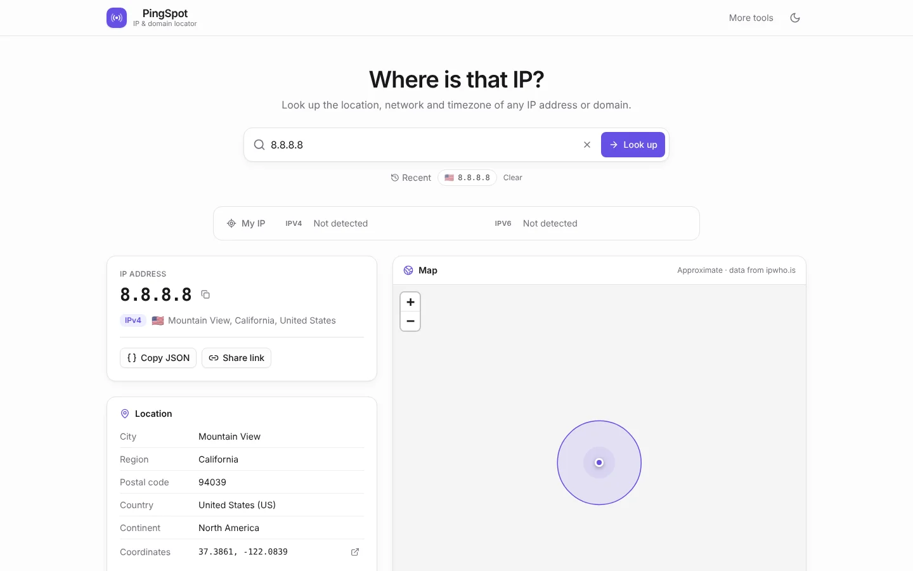

# PingSpot

An IP and domain locator by [Mohd Amir Khan](https://khanamir.me). It shows your public IPv4 and IPv6 addresses, and looks up the location, ISP, ASN and timezone of any IP address or domain on a map. Everything runs in the browser; there is no backend.

Live: **https://tool.khanamir.me/pingspot**



## Features

- Accepts IPv4, IPv6, domains and pasted URLs (`https://example.com/path`, `1.2.3.4:8080`, `[2001:db8::1]`)
- Resolves domains over DNS-over-HTTPS (Cloudflare) and then locates the address
- Explains private, loopback, CGNAT and other reserved ranges instead of sending them to an API
- Tries ipwho.is, then freeipapi.com, then geojs.io, and shows which one answered
- Map from OpenStreetMap tiles, with a dark version for dark mode
- Live local time for the address's timezone, ASN links to bgp.he.net, and coordinates that open in Google Maps
- Shareable `?q=` links that work with the back and forward buttons, recent lookups saved in local storage, and a `/` shortcut that focuses search
- Copy the IP address, the full result as JSON, or a share link
- Light, dark and system themes

## Run locally

```bash
npm install
npm run dev
```

Open [http://localhost:3000](http://localhost:3000). Locally the app runs at `/`; the `/pingspot` base path is only applied in CI.

Production build (static export to `out/`):

```bash
NEXT_PUBLIC_APP_URL=https://tool.khanamir.me/pingspot npm run build
```

`postbuild` writes `out/.htaccess` (404 page, caching, compression) for Hostinger.

## Deploy

GitHub Actions on `main` / `master` / `production` builds the static site with `NEXT_PUBLIC_APP_URL=https://tool.khanamir.me/pingspot` and uploads `out/` over FTPS to `/public_html/tool/pingspot/` (served as https://tool.khanamir.me/pingspot). The `FTP_SERVER`, `FTP_USERNAME` and `FTP_PASSWORD` repository secrets come from `~/.config/deploy/hostinger-ftp.env`:

```bash
gh secret set -f ~/.config/deploy/hostinger-ftp.env -R madmak787/PingSpot
```

With that login the FTP top level contains `public_html/`, so every path must start with `/public_html`. You can also run the workflow by hand from the Actions tab (**Build & Deploy PingSpot**).

`public/module_info.json` and `public/thumbnail.png` describe the tool for the catalog on tool.khanamir.me.
